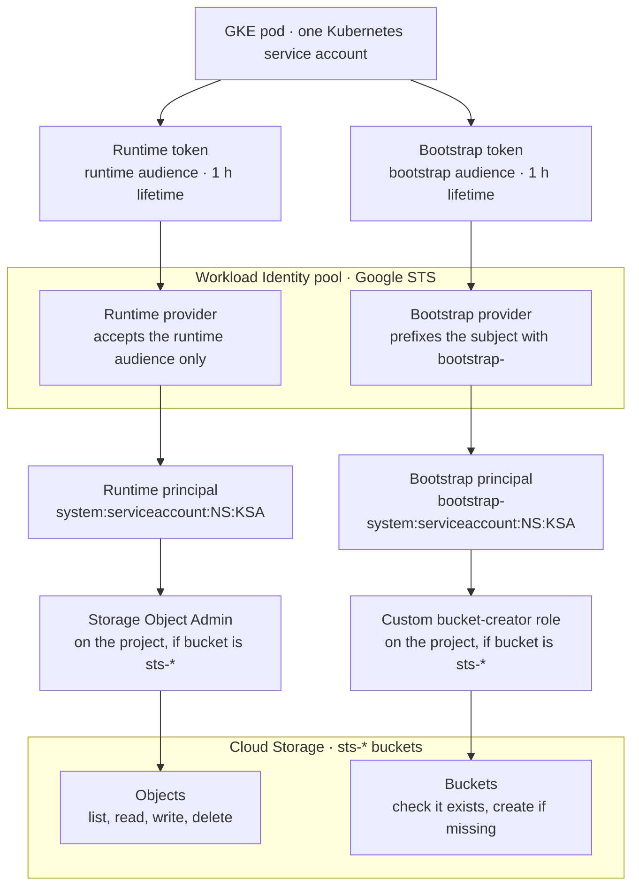
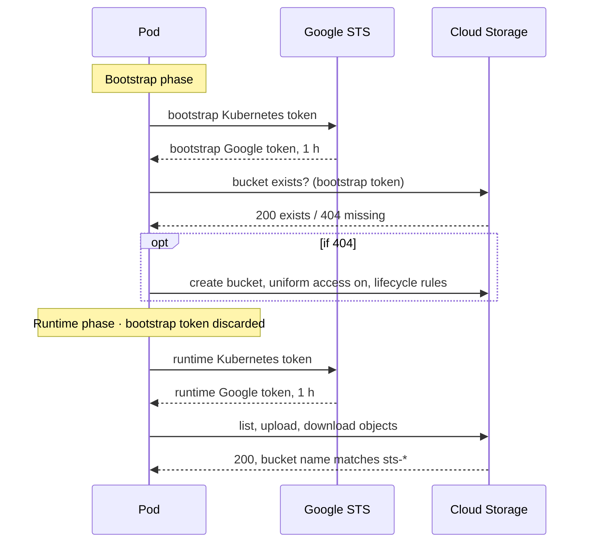

# GKE to GCS without service accounts — Workload Identity Federation design

A pod running on GKE reads and writes Cloud Storage with no stored key and no
Google service account. Its Kubernetes identity is exchanged for a
short-lived Google token, and Google IAM grants that federated identity
access directly.

The design has three parts:

- **Token exchange.** Kubernetes signs a short-lived token for the pod.
  Google's Security Token Service (STS) trusts that signature and returns a
  Google access token valid for about one hour.
- **Two tokens, two principals.** The same pod gets two tokens. One can only
  create buckets; the other can only work with objects. Neither can do the
  other's job.
- **Access by bucket name prefix.** Both grants apply to every bucket whose
  name starts with `sts-`, including buckets that don't exist yet. A bucket
  the pod creates is usable immediately, with no manual IAM step.
- **Lifecycle rules at creation.** Every bucket the pod creates starts with
  rules that move old objects to cheaper storage and delete them after a
  year, set in the same request that creates the bucket.

Nothing long-lived exists anywhere: no JSON key file, no secret, no refresh
token. Every credential the pod holds expires within an hour.

## Core concept: the trust chain

Google never sees a password from the pod. It trusts the GKE cluster's
signature on a Kubernetes token, and IAM decides what the resulting
identity may do.

1. **Kubernetes signs a token.** The cluster issues a short-lived token
   naming the pod's service account and an intended audience.
2. **Google trusts the cluster.** A Workload Identity pool holds providers
   that point at the cluster's public signing keys, so Google can verify
   tokens without any shared secret.
3. **STS exchanges it.** The pod sends its token to Google STS. STS checks
   the signature and audience, then returns a Google access token.
4. **The token carries a principal.** The provider maps the Kubernetes
   subject to a Google principal, for example
   `system:serviceaccount:default:sts-jitp-ksa`.
5. **IAM grants that principal access.** Roles are granted to the principal
   directly. No Google service account is involved, so there is no
   impersonation step and no extra API call.



Each column is one token's path. The two paths share the pod and the pool,
but split at the provider and never meet again.

## Token lifetimes and expiration

Every credential in the flow expires after one hour or less, and none can be
refreshed. To keep working, the pod gets a new Kubernetes token and
exchanges it again.

| Token | Issued by | Lifetime | Renewal |
| --- | --- | --- | --- |
| Kubernetes token, runtime | Kubernetes API server, written into the pod as a file | 3600 s (1 h), set in the pod spec; Kubernetes accepts 600 s minimum | Kubelet rewrites the file before expiry (after 80% of its lifetime); the pod just re-reads it |
| Kubernetes token, bootstrap | Same, second file, different audience | 3600 s (1 h) | Same as above |
| Google federated token, runtime | Google STS | About 1 h; the exchange response states the exact `expires_in` (3600 s in our runs) | None. No refresh token; exchange a fresh Kubernetes token again |
| Google federated token, bootstrap | Google STS | About 1 h | Not renewed: used once at startup, then discarded |

What this means in practice:

- **A one-shot job never sees an expiry.** It reads, exchanges and finishes
  within seconds.
- **A long-running service must re-exchange.** It should request a new
  Google token a few minutes before `expires_in` runs out, using the current
  contents of the token file.
- **A token's lifetime is not the lifetime of access.** Cloud Storage checks
  IAM on every request, so removing a grant cuts off a still-valid token.
  IAM changes can take a few minutes to apply.
- **A stolen token is useful for one hour at most.** There is no long-lived
  secret to rotate or revoke.
- **Tokens made by hand for local testing are not refreshed.** A token
  created with `kubectl create token --duration=1h` simply stops working
  after an hour.

## Multiple tokens: one identity, two principals

The pod holds two tokens because creating buckets and using objects should
never be the same permission. One Kubernetes service account requests two
tokens, each for a different audience. Google maps each audience to a
different principal.

The chain works like this:

1. Each token names its intended recipient in its **audience** (`aud`)
   claim. Kubernetes writes one token per audience into its own file in the
   pod.
2. The Workload Identity pool has **two providers**. Each one accepts only
   one audience, so a token meant for one provider is rejected by the other.
3. Each provider turns the token's subject into a Google identity. The
   runtime provider keeps it as is; the bootstrap provider adds a
   `bootstrap-` prefix. Same pod, two different principal names.
4. IAM grants each principal its own role. Neither grant mentions the other
   principal.

| | Runtime token | Bootstrap token |
| --- | --- | --- |
| Audience | `sts-jitp-audience` | `sts-jitp-bootstrap-audience` |
| Provider | `sts-jitp-provider` | `sts-jitp-provider-bootstrap` |
| Principal subject | `system:serviceaccount:<namespace>:<ksa>` | `bootstrap-system:serviceaccount:<namespace>:<ksa>` |
| Role | Storage Object Admin | Custom role: create a bucket, check one exists |
| Can do | List, read, write and delete objects | Create a bucket |
| Cannot do | Create or delete buckets | Read or write any object |
| Used | For all object work | Once at startup, then discarded |

The prefix is what makes two principals. Without it, both providers would
produce the same subject. Since providers in one pool share one namespace of
principals, both tokens would then carry the union of both grants.

## Access by bucket name pattern

Both roles are granted once, on the project, with a condition that limits
them to buckets named `sts-*`. That covers every matching bucket, including
ones that don't exist yet.

**Why not grant on the bucket itself.** A grant on a bucket can only be
added after the bucket exists. If the pod creates the bucket, nobody has
granted access to it yet, and the first run fails until someone adds the
grant by hand. A project-level grant with a name condition exists before the
bucket does.

**How the condition matches.** Cloud Storage names its resources like paths:

- a bucket: `projects/_/buckets/sts-originsolution`
- an object: `projects/_/buckets/sts-originsolution/objects/report.txt`

The condition checks one thing: does the name start with
`projects/_/buckets/sts-`? Both the bucket and every object inside it pass.
Any other bucket fails, so the grant gives nothing there.

```
resource.name.startsWith('projects/_/buckets/sts-')
```

**A prefix, not a regular expression.** IAM conditions do not support
regular expressions on resource names. They offer prefix and suffix tests
(`startsWith`, `endsWith`) and value extraction (`extract`). A prefix is
enough here, and easier to audit than a pattern would be.

Rules that come with this approach:

- **Every bucket must follow the naming rule.** A bucket named `origin-sts`
  gets no access at all. Bucket names are global across all of Google Cloud,
  so the project ID is added after the prefix (`sts-originsolution`).
- **Conditions need uniform bucket-level access.** Buckets created by the
  pod always have it switched on. Older buckets with per-object access lists
  do not.
- **The bootstrap grant uses the same condition.** It limits which bucket
  names the pod may create. Test that Google enforces it for bucket
  creation: creating `other-name` with the bootstrap token should fail with
  403.
- **The prefix is shared.** Any bucket anyone names `sts-…` in this project
  falls under both grants. Choose a prefix that nothing else uses.

## Lifecycle rules on new buckets

Buckets created by the pod get their lifecycle rules in the creation request
itself, so the bootstrap token needs no extra permission and no bucket is
ever left without rules.

The rules, kept in a JSON file next to the program:

| After | Applies to | Action |
| --- | --- | --- |
| 30 days | Objects still in Standard storage | Move to Coldline |
| 365 days | All objects | Delete |

**Why at creation, not afterwards.** Creating a bucket and changing an
existing one are different permissions. Rules sent with the creation request
are covered by the create permission the bootstrap role already has.
Changing rules later needs the update permission, which would also let the
pod change versioning, labels and retention on every `sts-*` bucket. The
bootstrap role deliberately doesn't get it.

What follows from that choice:

- **Existing buckets are left alone.** The pod only checks that they exist;
  it never changes them. To give an existing bucket the same rules, an
  administrator applies them once by hand:
  `gcloud storage buckets update gs://BUCKET --lifecycle-file=lifecycle.json`.
- **Rules are optional.** With no rules file configured, buckets are created
  exactly as before, without rules.
- **The file uses Google's own format.** It holds either
  `{"lifecycle": {"rule": [...]}}`, the format `gcloud` also accepts, or just
  `{"rule": [...]}`. Changing the rules means editing the file, not the
  program.
- **Rules run on Google's side.** Google evaluates them about once a day, so
  an object can move or disappear up to a day after its age is reached. No
  token is involved.

Costs to keep in mind:

- **Coldline has a 90-day minimum.** An object moved on day 30 is charged
  for 90 days of Coldline even if it is deleted sooner.
- **Reading Coldline costs extra per GB.** Objects read often should not be
  moved there. Nearline after 30 days, with a 30-day minimum, is the gentler
  choice.

## End-to-end flow at pod start

On every start the pod first makes sure its bucket exists, then works with
objects in it, all on the same run. Before the program starts, Kubernetes
has already written both token files into the pod.



The two exchanges are independent: the bootstrap token is used for the
bucket check and creation only, then dropped. If the bucket already exists,
the bootstrap phase ends after the check.

## Security properties and limits

The design removes long-lived secrets and splits duties, but it does not
protect against a fully compromised pod.

What it gives:

- **No secret to leak or rotate.** No key file, no stored password; the
  longest-lived credential lasts one hour.
- **Separation of duties.** The token that touches data cannot create
  buckets, and the token that creates buckets cannot touch data.
- **Narrow reach.** Access stops at the `sts-` prefix; other buckets in the
  project are untouched.
- **Auditable identity.** Every Cloud Storage request is logged under the
  Kubernetes namespace and service account that made it.

What it does not give:

- **Isolation inside the pod.** Both token files are mounted in the same
  pod. Whoever controls the pod can read both. The split guards against
  mistakes in the program, not against an attacker in the container.
- **Protection from token logging.** A token written to logs can be replayed
  by anyone who reads those logs, until it expires. Never log the Kubernetes
  token, the Google token or the `Authorization` header.
- **Isolation between workloads in one service account.** Every pod using
  the same Kubernetes service account and namespace gets the same
  principals. Give each workload its own service account.
- **Automatic cleanup of buckets.** Buckets the pod creates are not deleted
  by it; neither token is allowed to delete a bucket. The lifecycle rules
  delete old objects, never the bucket itself.
