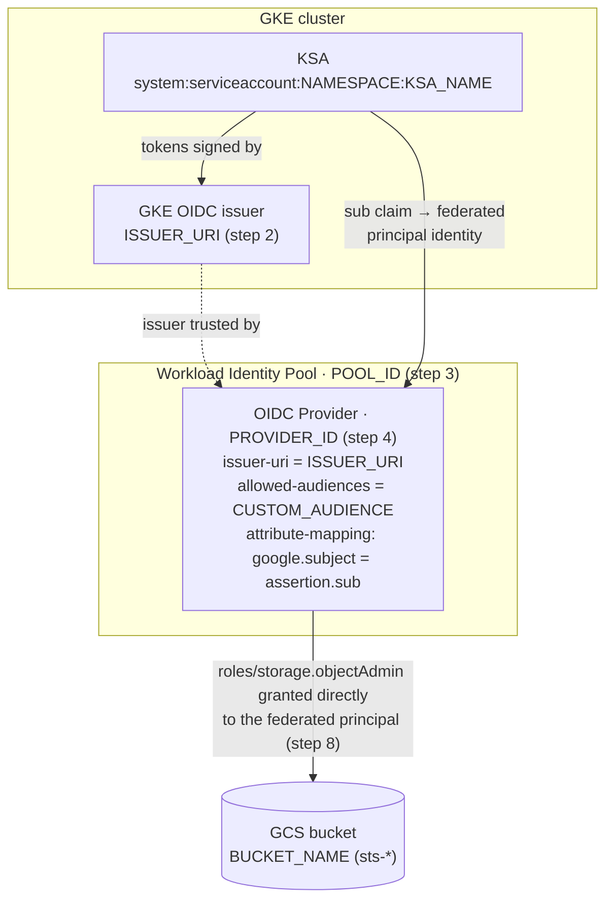
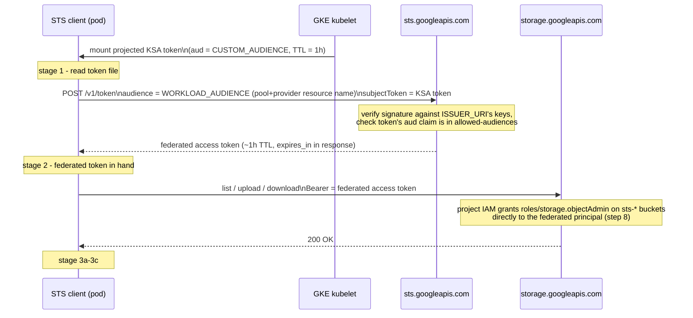
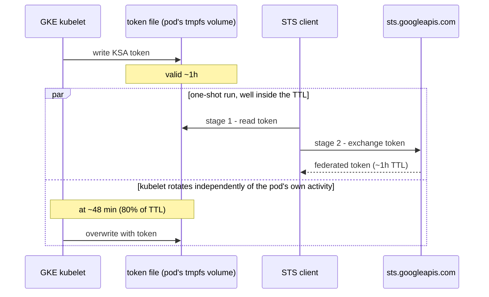
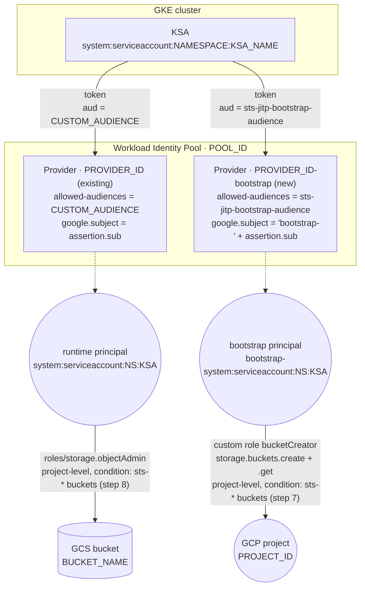
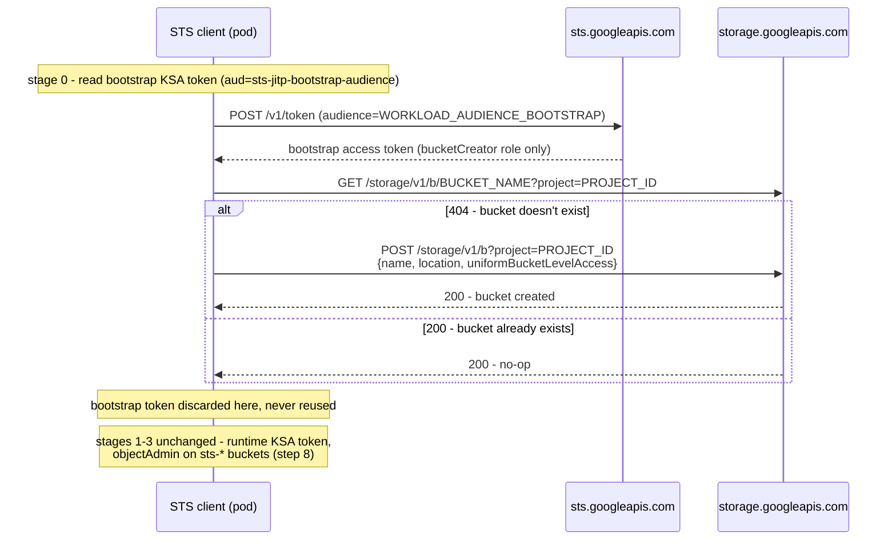

# STS-based Workload Identity Federation test (GKE → GCS, no GCP SDK)

Proves out authenticating a GKE pod to GCS purely via the STS token-exchange
API (`sts.googleapis.com`), bypassing GKE's built-in Workload Identity
metadata-server shortcut and any cloud SDK entirely. All calls are raw HTTP.

Flow: projected KSA OIDC token → STS token exchange → federated access
token → GCS JSON API (list / upload / download) with that token directly.
A second, separately-audienced token creates the bucket first if it
doesn't exist yet — see [Automatic bucket creation](#automatic-bucket-creation).

For the concepts without the code — token lifetimes, why there are two
tokens, and how the `sts-*` bucket-name condition works — see
[DESIGN.md](DESIGN.md).

The same flow is implemented three times, one per language — pick whichever
you want to read or run:

| Language | Source | Dependencies |
|---|---|---|
| Go (canonical — used for the Docker image / GKE pod) | [go/main.go](go/main.go) | none (standard library only) |
| C++20 | [cpp/main.cpp](cpp/main.cpp) (build via [cpp/build.ps1](cpp/build.ps1), no CMake needed) | WinHTTP (ships with Windows) + vendored [nlohmann/json](cpp/vendor/nlohmann/json.hpp) |
| Python 3 | [python/main.py](python/main.py) | none (standard library only) |

This uses **direct resource access**: a project IAM binding, conditioned
on the `sts-` bucket-name prefix, grants `roles/storage.objectAdmin`
straight to the federated principal (README step 8) instead of impersonating a Google Service Account — no GSA, no
`iamcredentials.googleapis.com` call, fewer resources to keep in sync.

## How it fits together

**Trust setup** (the static GCP resources created once in Part 1 — nothing
here happens at request time):



**Runtime flow** (what the STS client does each run, stage numbers match
its log output):



The two "audience" values are checked in different places and are easy to
mix up: `CUSTOM_AUDIENCE` is baked into the KSA token itself (set on the pod
spec) and validated by the Provider's `--allowed-audiences`; `WORKLOAD_AUDIENCE`
is a parameter of the STS *request* that just tells `sts.googleapis.com`
which pool/provider config to validate against — it's never compared to
anything inside the JWT.

## Token lifetimes & renewal

| Token | Lifetime | Renewed by | How |
|---|---|---|---|
| Projected KSA token — real pod ([k8s/pod.yaml:75](k8s/pod.yaml#L75), `expirationSeconds: 3600`) | 1h, requested | GKE kubelet, automatically | Rewrites the file in place once it crosses ~80% of its TTL (~48 min in) — no pod restart, transparent to the container |
| KSA token — local testing (`kubectl create token ... --duration=1h`) | 1h | You, manually | Not auto-rotated; re-run the command (`.\rerun.ps1 -Local` already does this every time) |
| Federated access token (STS exchange, stage 2) | ~1h, reported in `expires_in` on the stage 2 log line | Nobody — no refresh grant exists | Redo the whole STS exchange with a still-valid KSA token to get a new one |

Each implementation ([go/main.go](go/main.go), [cpp/main.cpp](cpp/main.cpp),
[python/main.py](python/main.py)) is one-shot — it reads the KSA token once,
exchanges it once, and finishes stages 3a-3c in well under a second, so none
of this expiry is ever visible within a single run. The rotation only
matters *across* runs (a stale `token.txt`) or if this were a long-running
daemon instead of a one-shot test:



What a long-running variant would need to add (nothing the STS client does
this today, since it doesn't need to):
- **Re-read** the KSA token file before each STS exchange instead of
  caching the value from stage 1 — cheap, and automatically picks up
  whatever the kubelet last rotated in.
- **Track the federated token's `expires_in`** and redo the STS exchange
  once it's close to expiry (e.g. <5 min left). "Renewal" here just means
  "exchange again" — there's no refresh-token flow for either token.
- No change needed to the GCS calls themselves — they just use whichever
  token is currently valid.

## Prerequisites

All the placeholder values used below live in [env.sh](env.sh) (bash) /
[env.ps1](env.ps1) (PowerShell) — same variables, same derived values, pick
whichever matches your shell. Edit the placeholders (`PROJECT_ID`,
`LOCATION`, `CLUSTER_NAME`, `BUCKET_NAME`, ...) then load them once per
session:

```bash
# bash / Git Bash
source env.sh
```

```powershell
# PowerShell — dot-sourcing (the leading ". " is required, not optional)
. .\env.ps1
```

Either one also computes the derived values used later — `PROJECT_NUMBER`,
`ISSUER_URI`, `WORKLOAD_AUDIENCE`, `WORKLOAD_AUDIENCE_BOOTSTRAP`, `IMAGE`
— so you won't need to construct those by hand.

> **Note:** the command blocks below are shown in PowerShell (`$env:VAR`,
> `` ` `` line continuations). If you're in bash/Git Bash instead, use the
> same `gcloud`/`docker`/`kubectl` arguments with `"$VAR"` and `\`
> continuations — the values from `env.sh` are identical.

## Part 1 — GCP setup

1. Enable required APIs (`iamcredentials.googleapis.com` isn't needed —
   direct resource access skips service account impersonation entirely):

   ```powershell
   gcloud services enable iam.googleapis.com sts.googleapis.com storage.googleapis.com container.googleapis.com --project="$env:PROJECT_ID"
   ```

2. Confirm the GKE cluster's OIDC issuer (the cluster is the external IdP
   for this test). `$env:ISSUER_URI` is already set by `env.ps1`; this just
   verifies the cluster exists and is reachable:

   ```powershell
   gcloud container clusters describe "$env:CLUSTER_NAME" --location "$env:LOCATION" --project "$env:PROJECT_ID"
   ```

3. Create the workload identity pool:

   ```powershell
   gcloud iam workload-identity-pools create "$env:POOL_ID" `
     --project="$env:PROJECT_ID" --location="global" `
     --display-name="$env:POOL_ID"
   ```

4. Create the OIDC provider inside the pool, pointed at the cluster issuer,
   with a custom allowed audience so the KSA token's `aud` claim doesn't
   need to be the full provider resource path:

   ```powershell
   gcloud iam workload-identity-pools providers create-oidc "$env:PROVIDER_ID" `
     --project="$env:PROJECT_ID" --location="global" `
     --workload-identity-pool="$env:POOL_ID" `
     --issuer-uri="$env:ISSUER_URI" `
     --attribute-mapping="google.subject=assertion.sub" `
     --allowed-audiences="$env:CUSTOM_AUDIENCE"
   ```

5. Create a **second** OIDC provider in the same pool, for bucket creation
   only. Same cluster issuer, different allowed audience, and an
   attribute mapping that maps the *same* KSA to a *different* subject
   (`bootstrap-` prefix) so it resolves to a different, narrower-scoped
   principal — see [Automatic bucket creation](#automatic-bucket-creation)
   below for why this is a second provider instead of a broader grant on
   the existing one:

   ```powershell
   gcloud iam workload-identity-pools providers create-oidc "$env:PROVIDER_ID_BOOTSTRAP" `
     --project="$env:PROJECT_ID" --location="global" `
     --workload-identity-pool="$env:POOL_ID" `
     --issuer-uri="$env:ISSUER_URI" `
     --attribute-mapping="google.subject='bootstrap-' + assertion.sub" `
     --allowed-audiences="$env:CUSTOM_AUDIENCE_BOOTSTRAP"
   ```

6. Create a minimal custom role — just enough to create a bucket and
   check whether it already exists, nothing else (no object access, no
   bucket IAM control):

   ```powershell
   gcloud iam roles create "$env:BOOTSTRAP_ROLE_ID" --project="$env:PROJECT_ID" `
     --title="Bucket Creator (bootstrap)" `
     --permissions="storage.buckets.create,storage.buckets.get"
   ```

7. Grant that role to the bootstrap principal only. It has to be **at the
   project level** (the bucket doesn't exist yet, so it can't be a
   bucket-level binding), but an IAM condition limits it to bucket names
   starting with `BUCKET_PREFIX` (`sts-`):

   ```powershell
   gcloud projects add-iam-policy-binding "$env:PROJECT_ID" `
     --member="principal://iam.googleapis.com/projects/$($env:PROJECT_NUMBER)/locations/global/workloadIdentityPools/$($env:POOL_ID)/subject/bootstrap-system:serviceaccount:$($env:NAMESPACE):$($env:KSA_NAME)" `
     --role="projects/$($env:PROJECT_ID)/roles/$($env:BOOTSTRAP_ROLE_ID)" `
     --condition="expression=resource.name.startsWith('projects/_/buckets/$($env:BUCKET_PREFIX)'),title=$($env:BUCKET_PREFIX)buckets-only"
   ```

   > **Verify this condition is enforced** for `storage.buckets.create`
   > before relying on it: with the bootstrap token, try creating a bucket
   > whose name does *not* start with `BUCKET_PREFIX` and confirm it gets a
   > 403. If it succeeds, the condition isn't evaluated for bucket creation
   > and the bootstrap principal can create any bucket in the project.

8. Grant the *runtime* federated principal direct access to every
   `BUCKET_PREFIX*` bucket — **direct resource access**: no GSA, no
   impersonation, one binding straight to the KSA's federated identity.
   Like step 7, it's a project-level binding with a bucket-name condition,
   so it already covers buckets stage 0 hasn't created yet, and grants
   nothing on any other bucket:

   ```powershell
   gcloud projects add-iam-policy-binding "$env:PROJECT_ID" `
     --member="principal://iam.googleapis.com/projects/$($env:PROJECT_NUMBER)/locations/global/workloadIdentityPools/$($env:POOL_ID)/subject/system:serviceaccount:$($env:NAMESPACE):$($env:KSA_NAME)" `
     --role="roles/storage.objectAdmin" `
     --condition="expression=resource.name.startsWith('projects/_/buckets/$($env:BUCKET_PREFIX)'),title=$($env:BUCKET_PREFIX)buckets-only"
   ```

   > **Why one prefix condition covers buckets and objects:** GCS resource
   > names are `projects/_/buckets/<bucket>` and
   > `projects/_/buckets/<bucket>/objects/<object>`, so one `startsWith`
   > matches both the bucket-level checks (e.g. `storage.objects.list`) and
   > the object-level ones. Conditions require uniform bucket-level access,
   > which stage 0 enables on every bucket it creates. Steps 1–8 can now be
   > run in one go — no first run is needed before step 8 — though new IAM
   > bindings can take a minute or two to apply, so a run immediately
   > afterwards may still get a 403.

   The workload audience strings needed by the pod/client are already
   available as `$env:WORKLOAD_AUDIENCE` / `$env:WORKLOAD_AUDIENCE_BOOTSTRAP`
   (set by `env.ps1`):

   ```powershell
   echo $env:WORKLOAD_AUDIENCE
   echo $env:WORKLOAD_AUDIENCE_BOOTSTRAP
   ```

## Part 2 — Kubernetes setup

The KSA and pod are defined together in [k8s/pod.yaml](k8s/pod.yaml). Edit
that file's placeholders (`PROJECT_ID`, `PROJECT_NUMBER`, `LOCATION`,
`POOL_ID`, `PROVIDER_ID`, `PROVIDER_ID_BOOTSTRAP`, `CUSTOM_AUDIENCE`,
`CUSTOM_AUDIENCE_BOOTSTRAP`, `BUCKET_NAME`, `NAMESPACE`, `IMAGE`) to match
the values set above, then apply once the image is built (next section).
Its two projected token volumes (`gcp-ksa-token`, `gcp-ksa-bootstrap-token`)
give the pod the two federated tokens stage 0 and stages 1-3 each need —
see [Automatic bucket creation](#automatic-bucket-creation).

## Build & run

Create an Artifact Registry repo to hold the image (one-time):

```powershell
gcloud artifacts repositories create sts-test `
  --project="$env:PROJECT_ID" --location="$env:LOCATION" `
  --repository-format=docker `
  --description="sts-test container image"
```

Authenticate Docker to that registry, then build, push, and deploy
(`$env:IMAGE` is already set by `env.ps1`):

```powershell
gcloud auth configure-docker "$($env:LOCATION)-docker.pkg.dev"

docker build -t "$env:IMAGE" .
docker push "$env:IMAGE"

# set k8s/pod.yaml's IMAGE field to $env:IMAGE, then:
# (-creplace is case-sensitive: -replace would also clobber the lowercase
# "image:" YAML key, not just the IMAGE placeholder)
(Get-Content k8s/pod.yaml) -creplace 'IMAGE', $env:IMAGE | Set-Content k8s/pod.yaml
kubectl apply -f k8s/pod.yaml
kubectl logs -f sts-test -n "$env:NAMESPACE"
```

## Running it again

`sts-test` (via the pod) and the STS client (locally) are both safe to re-run
as many times as you like — each run just overwrites the same
`sts-test-object.txt` in the bucket, no state accumulates. [rerun.ps1](rerun.ps1)
wraps the two cycles below:

```powershell
.\rerun.ps1          # delete + reapply the GKE pod, stream its logs
.\rerun.ps1 -Local   # mint a fresh KSA token and run the STS client locally
```

(A bare `kubectl apply -f k8s/pod.yaml` on its own won't rerun a finished
pod — `restartPolicy: Never` means the Pod object has to be deleted first,
which is what the non-`-Local` path does for you.)

## Local testing (no pod deploy needed)

You don't need to build/push/deploy to try the flow end to end — the only
thing a real pod gives you that you're otherwise missing locally is the
projected KSA token file. `kubectl create token` mints an equivalent one
on demand via the same TokenRequest mechanism the kubelet uses for the
projected volume, signed by the same cluster issuer — STS can't tell the
difference.

```powershell
# point kubectl at the cluster
gcloud container clusters get-credentials $env:CLUSTER_NAME --location $env:LOCATION --project $env:PROJECT_ID

# create the KSA if it doesn't exist yet (k8s/pod.yaml defines the same one)
kubectl create serviceaccount $env:KSA_NAME -n $env:NAMESPACE --dry-run=client -o yaml | kubectl apply -f -

# mint bound tokens with the same audiences the pod would request -
# one for object ops (runtime), one for bucket creation (bootstrap)
kubectl create token $env:KSA_NAME -n $env:NAMESPACE --audience=$env:CUSTOM_AUDIENCE --duration=1h > token.txt
kubectl create token $env:KSA_NAME -n $env:NAMESPACE --audience=$env:CUSTOM_AUDIENCE_BOOTSTRAP --duration=1h > token-bootstrap.txt
```

Then run any of the three implementations directly against those tokens
(`env.ps1` already set `WORKLOAD_AUDIENCE`, `WORKLOAD_AUDIENCE_BOOTSTRAP`,
`PROJECT_ID`, `LOCATION`, `BUCKET_NAME` in your session — only the two
`*_TOKEN_PATH` vars are new):

```powershell
$env:KSA_TOKEN_PATH = (Resolve-Path token.txt).Path
$env:KSA_BOOTSTRAP_TOKEN_PATH = (Resolve-Path token-bootstrap.txt).Path

go -C go run .            # Go
.\cpp\build.ps1; .\cpp\sts-test.exe   # C++20 (build.ps1 only needs to run once)
python python/main.py    # Python 3
```

Or run the built container image the same way, mounting both tokens in
place of the pod's two projected volumes:

```powershell
docker run --rm `
  -e KSA_TOKEN_PATH=/token `
  -e WORKLOAD_AUDIENCE=$env:WORKLOAD_AUDIENCE `
  -e KSA_BOOTSTRAP_TOKEN_PATH=/token-bootstrap `
  -e WORKLOAD_AUDIENCE_BOOTSTRAP=$env:WORKLOAD_AUDIENCE_BOOTSTRAP `
  -e PROJECT_ID=$env:PROJECT_ID `
  -e LOCATION=$env:LOCATION `
  -e BUCKET_NAME=$env:BUCKET_NAME `
  -v "${PWD}/token.txt:/token:ro" `
  -v "${PWD}/token-bootstrap.txt:/token-bootstrap:ro" `
  $env:IMAGE
```

`token.txt` / `token-bootstrap.txt` are live (if short-lived) credentials —
don't commit them or paste them anywhere; delete them after you're done
testing.

## Expected output

```
stage 0a: reading bootstrap subject token from /var/run/secrets/tokens/gcp-ksa-bootstrap/token
stage 0a: OK (token length ...)
stage 0b: exchanging bootstrap subject token at STS for audience //iam.googleapis.com/...
stage 0b: OK, bootstrap token type=Bearer expires_in=3600s
stage 0c: checking whether gs://your-bucket-name exists
stage 0c: OK, bucket already exists
stage 1: reading subject token from /var/run/secrets/tokens/gcp-ksa/token
stage 1: OK (token length ...)
stage 2: exchanging subject token at STS for audience //iam.googleapis.com/...
stage 2: OK, federated token type=Bearer expires_in=3600s
stage 3a: listing objects in gs://your-bucket-name
stage 3a: OK, found N object(s)
stage 3b: uploading gs://your-bucket-name/sts-test-object.txt (... bytes)
stage 3b: OK
stage 3c: downloading gs://your-bucket-name/sts-test-object.txt
stage 3c: OK, downloaded content matches uploaded content
all stages passed
```

## Debugging failure paths

- Bad/mismatched audience (pod `audience` vs. provider `--allowed-audiences`)
  → STS returns `invalid_target` with a descriptive message, surfaced verbatim
  by the STS client.
- Missing/wrong IAM binding on the runtime federated principal (step 8)
  → stage 3a-3c GCS calls return a 403 from `storage.googleapis.com`.
- `BUCKET_NAME` not starting with `BUCKET_PREFIX` → the conditions in
  steps 7–8 don't match, so stage 0c (or stage 3a, if the bucket already
  exists) gets a 403.
- Missing/wrong project IAM binding on the *bootstrap* principal (step 7),
  or the custom role not created yet (step 6) → stage 0c fails with a 403
  instead, before stage 1 even runs.
- Wrong `subject` string in either `--member` binding (namespace/KSA name
  mismatch, or a missing/typo'd `bootstrap-` prefix) → same 403, since the
  federated principal simply won't match any grant.

## Automatic bucket creation

`BUCKET_NAME` no longer has to exist ahead of time — each client creates
it itself, on every run, before touching anything else (stage 0 in the
log output; see [go/main.go](go/main.go), [python/main.py](python/main.py),
[cpp/main.cpp](cpp/main.cpp)). This works without weakening the runtime
token's privileges and without introducing a service account key or
impersonation.

The problem it solves: the client's runtime federated token is
deliberately scoped to `roles/storage.objectAdmin` on `sts-*` buckets.
Reusing it to also create buckets would mean also granting it
`storage.buckets.create` — one identity that can both create buckets and
read/write every object in them.

The fix is a **second federated token**, kept narrower, not broader: the
same KSA requests a token with a *different* `audience`, validated by a
*second* WIF provider in the same pool, mapped to a *different* principal
with its own, much smaller grant:



Same KSA, same physical pod identity — but two tokens, two principals, two
IAM grants that can't do each other's job: the bootstrap principal can
never read or write an object, and the runtime principal still can't
create or delete a bucket.

Runtime sequence with a new stage 0 in front of the existing stages 1-3:



### Lifecycle rules on created buckets

When `LIFECYCLE_FILE` is set, stage 0 sends the rules from that file in the
same bucket-create request, so every bucket it creates starts with them. The
repo's [lifecycle.json](lifecycle.json) moves objects to `COLDLINE` after 30
days and deletes them after 365. `env.ps1` / `env.sh` point
`LIFECYCLE_FILE` at it for local runs; the Docker image ships it as
`/lifecycle.json` and [k8s/pod.yaml](k8s/pod.yaml) points there.

- Setting rules at creation needs only `storage.buckets.create`, which the
  bootstrap role already has. Changing them on an existing bucket needs
  `storage.buckets.update`, which it deliberately doesn't — stage 0 never
  modifies a bucket that already exists. For those, apply the rules by hand:
  `gcloud storage buckets update gs://BUCKET --lifecycle-file=lifecycle.json`.
- The file may contain `{"lifecycle": {"rule": [...]}}` (the format above,
  also accepted by `gcloud`) or just `{"rule": [...]}`.
- Check the result with
  `gcloud storage buckets describe gs://BUCKET --format="json(lifecycle_config)"`.

### What this needed

| Layer | Change |
|---|---|
| GCP (Part 1, steps 5–7) | Second provider (`PROVIDER_ID_BOOTSTRAP`) in the same pool; custom IAM role `bucketCreator` (`storage.buckets.create`, `storage.buckets.get`) bound at **project** level to the bootstrap principal only, conditioned on the `sts-*` bucket-name prefix; step 8's runtime binding uses the same condition, so a freshly created bucket is usable on the same run |
| Kubernetes ([k8s/pod.yaml](k8s/pod.yaml)) | Second projected token volume on the same pod, `audience: sts-jitp-bootstrap-audience`, separate mount path (`/var/run/secrets/tokens/gcp-ksa-bootstrap/token`) |
| App code (all three languages) | Stage 0: read bootstrap token → STS exchange against `WORKLOAD_AUDIENCE_BOOTSTRAP` → `GET`/`POST` on `storage.googleapis.com/storage/v1/b` to create-if-missing, before stage 1 |

Trade-off worth knowing about: this is meaningfully more moving parts (one
extra provider, one extra custom role, one extra token volume, one extra
stage in three codebases) than just running `gcloud storage buckets create`
once, by hand, before Part 1. It earns its keep only because bucket
creation needed to happen unattended, on every pod start, with nobody
running `gcloud` first — the requirement this project started from.
