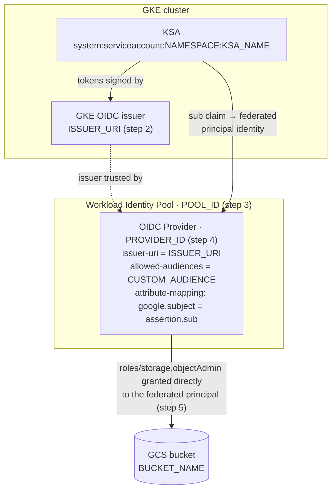
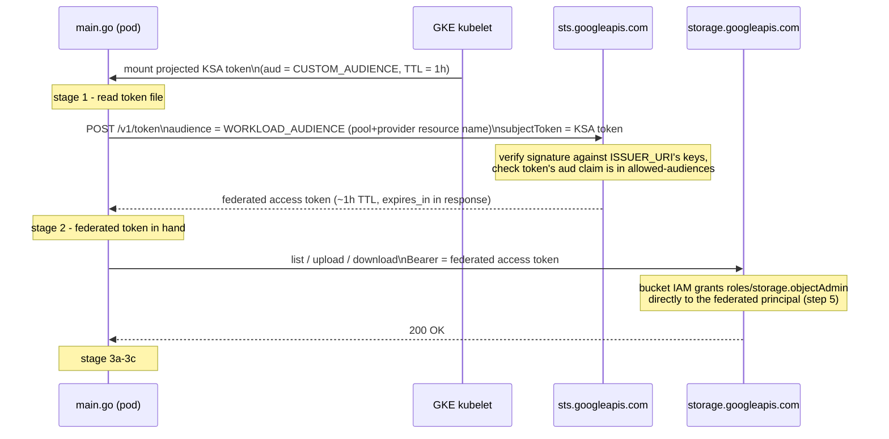

# STS-based Workload Identity Federation test (GKE → GCS, no GCP SDK)

Proves out authenticating a GKE pod to GCS purely via the STS token-exchange
API (`sts.googleapis.com`), bypassing GKE's built-in Workload Identity
metadata-server shortcut and `google-cloud-go/storage` entirely. All calls
are raw HTTP (see [main.go](main.go)).

Flow: projected KSA OIDC token → STS token exchange → federated access
token → GCS JSON API (list / upload / download) with that token directly.

This uses **direct resource access**: the bucket's IAM policy grants
`roles/storage.objectAdmin` straight to the federated principal (README
step 5) instead of impersonating a Google Service Account — no GSA, no
`iamcredentials.googleapis.com` call, fewer resources to keep in sync.

## How it fits together

**Trust setup** (the static GCP resources created once in Part 1 — nothing
here happens at request time):



**Runtime flow** (what `main.go` actually does each run, stage numbers match
its log output):



The two "audience" values are checked in different places and are easy to
mix up: `CUSTOM_AUDIENCE` is baked into the KSA token itself (set on the pod
spec) and validated by the Provider's `--allowed-audiences`; `WORKLOAD_AUDIENCE`
is a parameter of the STS *request* that just tells `sts.googleapis.com`
which pool/provider config to validate against — it's never compared to
anything inside the JWT.

## Token lifetimes & renewal

| Token | Lifetime | Renewed by | How |
|---|---|---|---|
| Projected KSA token — real pod ([k8s/pod.yaml:51](k8s/pod.yaml#L51), `expirationSeconds: 3600`) | 1h, requested | GKE kubelet, automatically | Rewrites the file in place once it crosses ~80% of its TTL (~48 min in) — no pod restart, transparent to the container |
| KSA token — local testing (`kubectl create token ... --duration=1h`) | 1h | You, manually | Not auto-rotated; re-run the command (`.\rerun.ps1 -Local` already does this every time) |
| Federated access token (STS exchange, stage 2) | ~1h, reported in `expires_in` on the stage 2 log line | Nobody — no refresh grant exists | Redo the whole STS exchange with a still-valid KSA token to get a new one |

`main.go` is one-shot — it reads the KSA token once, exchanges it once, and
finishes stages 3a-3c in well under a second, so none of this expiry is
ever visible within a single run. The rotation only matters *across* runs
(a stale `token.txt`) or if this were a long-running daemon instead of a
one-shot test:


What a long-running variant would need to add (nothing in `main.go` does
this today, since it doesn't need to):
- **Re-read** the KSA token file before each STS exchange instead of
  caching the value from stage 1 — cheap, and automatically picks up
  whatever the kubelet last rotated in.
- **Track the federated token's `expires_in`** and redo the STS exchange
  once it's close to expiry (e.g. <5 min left). "Renewal" here just means
  "exchange again" — there's no refresh-token flow for either token.
- No change needed to the GCS calls themselves — they just use whichever
  token is currently valid.

## Prerequisites

All the placeholder values used below live in [env.sh](env.sh) (bash) /
[env.ps1](env.ps1) (PowerShell) — same variables, same derived values, pick
whichever matches your shell. Edit the placeholders (`PROJECT_ID`,
`LOCATION`, `CLUSTER_NAME`, `BUCKET_NAME`, ...) then load them once per
session:

```bash
# bash / Git Bash
source env.sh
```

```powershell
# PowerShell — dot-sourcing (the leading ". " is required, not optional)
. .\env.ps1
```

Either one also computes the derived values used later — `PROJECT_NUMBER`,
`ISSUER_URI`, `WORKLOAD_AUDIENCE`, `IMAGE` — so you won't need to construct
those by hand.

> **Note:** the command blocks below are shown in PowerShell (`$env:VAR`,
> `` ` `` line continuations). If you're in bash/Git Bash instead, use the
> same `gcloud`/`docker`/`kubectl` arguments with `"$VAR"` and `\`
> continuations — the values from `env.sh` are identical.

## Part 1 — GCP setup

1. Enable required APIs (`iamcredentials.googleapis.com` isn't needed —
   direct resource access skips service account impersonation entirely):

   ```powershell
   gcloud services enable iam.googleapis.com sts.googleapis.com storage.googleapis.com container.googleapis.com --project="$env:PROJECT_ID"
   ```

2. Confirm the GKE cluster's OIDC issuer (the cluster is the external IdP
   for this test). `$env:ISSUER_URI` is already set by `env.ps1`; this just
   verifies the cluster exists and is reachable:

   ```powershell
   gcloud container clusters describe "$env:CLUSTER_NAME" --location "$env:LOCATION" --project "$env:PROJECT_ID"
   ```

3. Create the workload identity pool:

   ```powershell
   gcloud iam workload-identity-pools create "$env:POOL_ID" `
     --project="$env:PROJECT_ID" --location="global" `
     --display-name="$env:POOL_ID"
   ```

4. Create the OIDC provider inside the pool, pointed at the cluster issuer,
   with a custom allowed audience so the KSA token's `aud` claim doesn't
   need to be the full provider resource path:

   ```powershell
   gcloud iam workload-identity-pools providers create-oidc "$env:PROVIDER_ID" `
     --project="$env:PROJECT_ID" --location="global" `
     --workload-identity-pool="$env:POOL_ID" `
     --issuer-uri="$env:ISSUER_URI" `
     --attribute-mapping="google.subject=assertion.sub" `
     --allowed-audiences="$env:CUSTOM_AUDIENCE"
   ```

5. Grant the federated principal direct access to the bucket — **direct
   resource access**: no GSA, no impersonation, one binding straight to
   the KSA's federated identity:

   ```powershell
   gcloud storage buckets add-iam-policy-binding "gs://$($env:BUCKET_NAME)" `
     --member="principal://iam.googleapis.com/projects/$($env:PROJECT_NUMBER)/locations/global/workloadIdentityPools/$($env:POOL_ID)/subject/system:serviceaccount:$($env:NAMESPACE):$($env:KSA_NAME)" `
     --role="roles/storage.objectAdmin"
   ```

   The workload audience string needed by the pod/Go client is already
   available as `$env:WORKLOAD_AUDIENCE` (set by `env.ps1`):

   ```powershell
   echo $env:WORKLOAD_AUDIENCE
   ```

## Part 2 — Kubernetes setup

The KSA and pod are defined together in [k8s/pod.yaml](k8s/pod.yaml). Edit
that file's placeholders (`PROJECT_NUMBER`, `POOL_ID`, `PROVIDER_ID`,
`CUSTOM_AUDIENCE`, `BUCKET_NAME`, `NAMESPACE`, `IMAGE`) to match the values
set above, then apply once the image is built (next section).

## Build & run

Create an Artifact Registry repo to hold the image (one-time):

```powershell
gcloud artifacts repositories create sts-test `
  --project="$env:PROJECT_ID" --location="$env:LOCATION" `
  --repository-format=docker `
  --description="sts-test container image"
```

Authenticate Docker to that registry, then build, push, and deploy
(`$env:IMAGE` is already set by `env.ps1`):

```powershell
gcloud auth configure-docker "$($env:LOCATION)-docker.pkg.dev"

docker build -t "$env:IMAGE" .
docker push "$env:IMAGE"

# set k8s/pod.yaml's IMAGE field to $env:IMAGE, then:
# (-creplace is case-sensitive: -replace would also clobber the lowercase
# "image:" YAML key, not just the IMAGE placeholder)
(Get-Content k8s/pod.yaml) -creplace 'IMAGE', $env:IMAGE | Set-Content k8s/pod.yaml
kubectl apply -f k8s/pod.yaml
kubectl logs -f sts-test -n "$env:NAMESPACE"
```

## Running it again

`sts-test` (via the pod) and `main.go` (locally) are both safe to re-run
as many times as you like — each run just overwrites the same
`sts-test-object.txt` in the bucket, no state accumulates. [rerun.ps1](rerun.ps1)
wraps the two cycles below:

```powershell
.\rerun.ps1          # delete + reapply the GKE pod, stream its logs
.\rerun.ps1 -Local   # mint a fresh KSA token and run main.go locally
```

(A bare `kubectl apply -f k8s/pod.yaml` on its own won't rerun a finished
pod — `restartPolicy: Never` means the Pod object has to be deleted first,
which is what the non-`-Local` path does for you.)

## Local testing (no pod deploy needed)

You don't need to build/push/deploy to try the flow end to end — the only
thing a real pod gives you that you're otherwise missing locally is the
projected KSA token file. `kubectl create token` mints an equivalent one
on demand via the same TokenRequest mechanism the kubelet uses for the
projected volume, signed by the same cluster issuer — STS can't tell the
difference.

```powershell
# point kubectl at the cluster
gcloud container clusters get-credentials $env:CLUSTER_NAME --location $env:LOCATION --project $env:PROJECT_ID

# create the KSA if it doesn't exist yet (k8s/pod.yaml defines the same one)
kubectl create serviceaccount $env:KSA_NAME -n $env:NAMESPACE --dry-run=client -o yaml | kubectl apply -f -

# mint a bound token with the same audience the pod would request
kubectl create token $env:KSA_NAME -n $env:NAMESPACE --audience=$env:CUSTOM_AUDIENCE --duration=1h > token.txt
```

Then run the Go program directly against that token (`env.ps1` already set
`WORKLOAD_AUDIENCE`, `BUCKET_NAME` in your session — only `KSA_TOKEN_PATH`
is new):

```powershell
$env:KSA_TOKEN_PATH = (Resolve-Path token.txt).Path
go run .
```

Or run the built container image the same way, mounting the token in place
of the pod's projected volume:

```powershell
docker run --rm `
  -e KSA_TOKEN_PATH=/token `
  -e WORKLOAD_AUDIENCE=$env:WORKLOAD_AUDIENCE `
  -e BUCKET_NAME=$env:BUCKET_NAME `
  -v "${PWD}/token.txt:/token:ro" `
  $env:IMAGE
```

`token.txt` is a live (if short-lived) credential — don't commit it or
paste it anywhere; delete it after you're done testing.

## Expected output

```
stage 1: reading subject token from /var/run/secrets/tokens/gcp-ksa/token
stage 1: OK (token length ...)
stage 2: exchanging subject token at STS for audience //iam.googleapis.com/...
stage 2: OK, federated token type=Bearer expires_in=3600s
stage 3a: listing objects in gs://your-bucket-name
stage 3a: OK, found N object(s)
stage 3b: uploading gs://your-bucket-name/sts-test-object.txt (... bytes)
stage 3b: OK
stage 3c: downloading gs://your-bucket-name/sts-test-object.txt
stage 3c: OK, downloaded content matches uploaded content
all stages passed
```

## Debugging failure paths

- Bad/mismatched audience (pod `audience` vs. provider `--allowed-audiences`)
  → STS returns `invalid_target` with a descriptive message, surfaced verbatim
  by `main.go`.
- Missing/wrong bucket IAM binding on the federated principal (step 5) → GCS
  list/upload/download calls return a 403 from `storage.googleapis.com`.
- Wrong `subject` string in the `--member` binding (namespace/KSA name
  mismatch) → same 403, since the federated principal simply won't match
  any grant on the bucket.
